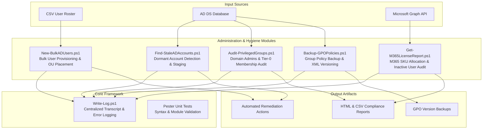

# Enterprise Active Directory & Microsoft 365 Automation Suite

## Overview
A modular, production-ready PowerShell automation toolkit engineered for enterprise identity management, Active Directory Domain Services (AD DS) hygiene, Microsoft 365 tenant administration, and security compliance auditing. 

Every script is built according to enterprise PowerShell best practices, featuring advanced function support (`[CmdletBinding()]`), parameter validation, `-WhatIf` / `-Confirm` safety gates, structured transcript logging, and Pester unit test coverage.



---

## Toolkit Architecture & Script Inventory

| Script | Domain | Primary Function | Safety Controls |
| :--- | :--- | :--- | :--- |
| **`New-BulkADUsers.ps1`** | Identity Provisioning | Creates users from CSV with randomized secure passwords, standard OU routing, and baseline security groups. | `-WhatIf`, Duplicate UPN check |
| **`Find-StaleADAccounts.ps1`** | Hygiene & Deprovisioning | Identifies user/computer accounts inactive $\ge$ 90 days; optionally disables and moves to Stale Quarantine OU. | `-WhatIf`, `-DaysInactive`, Exclusion lists |
| **`Audit-PrivilegedGroups.ps1`** | SecOps & Compliance | Audits recursive memberships in Tier-0 groups (*Domain Admins*, *Enterprise Admins*, *Schema Admins*). | Read-only, Baseline diff alerting |
| **`Get-M365LicenseReport.ps1`** | Cloud Governance | Scans Entra ID / M365 tenants via Microsoft Graph to detect licensed users inactive $\ge$ 60 days to reclaim costs. | Read-only, Export to CSV/HTML |
| **`Backup-GPOPolicies.ps1`** | Disaster Recovery | Exports and archives all domain Group Policy Objects with timestamps, XML metadata reports, and retention policies. | Read-only, Retention pruning |

---

## Enterprise Engineering Standards

* **Idempotent & Safe Execution:** State-changing scripts support `SupportsShouldProcess` (`-WhatIf` and `-Confirm`) to allow administrators to simulate actions before making live directory modifications.
* **Zero Hardcoded Credentials:** Designed for use with Microsoft Graph delegated authentication, managed service accounts, or credential parameters via `Get-Credential`.
* **Structured Logging:** Centralized logging module (`Write-Log.ps1`) writes color-coded console output and timestamped log files with standardized log levels (`INFO`, `WARN`, `ERROR`, `DEBUG`).
* **Test-Driven Automation:** Includes Pester test suites (`Tests/`) validating parameter bindings, mandatory attributes, and mock directory responses.

---

## Script Modules & Code Examples

### 1. Bulk User Provisioning (`New-BulkADUsers.ps1`)
Provisions new Active Directory accounts from an HR intake CSV with automated UPN generation, department OU mapping, and randomized temporary passwords set to expire on initial logon.

```powershell
# Preview bulk provisioning without making changes
.\New-BulkADUsers.ps1 -CsvPath ".\Data\NewHires.csv" -TargetOU "OU=Employees,DC=enterprise,DC=local" -WhatIf

# Execute live provisioning with transcript logging
.\New-BulkADUsers.ps1 -CsvPath ".\Data\NewHires.csv" -TargetOU "OU=Employees,DC=enterprise,DC=local" -SendWelcomeEmail
```

---

### 2. Stale Account Detection & Quarantine (`Find-StaleADAccounts.ps1`)
Queries the domain for accounts whose `lastLogonDate` or `pwdLastSet` exceeds the inactivity threshold.

```powershell
# Identify user accounts inactive for 90+ days
.\Find-StaleADAccounts.ps1 -DaysInactive 90 -AccountType "User" -ReportOnly

# Quarantine stale accounts to designated OU
.\Find-StaleADAccounts.ps1 -DaysInactive 90 -AccountType "User" -DisableAccounts -MoveToOU "OU=Quarantine,DC=enterprise,DC=local"
```

#### Sample Output Report (`Outputs/Stale_Users_Report.csv`)
| SamAccountName | UserPrincipalName | LastLogonDate | PasswordLastSet | DaysInactive | Status |
| :--- | :--- | :--- | :--- | :--- | :--- |
| `jdoe_contractor` | `jdoe@enterprise.local` | `2026-04-12` | `2026-01-10` | `135` | **Quarantined** |
| `temp_service_test` | `temp_svc@enterprise.local` | `2026-02-01` | `2025-11-20` | `205` | **Quarantined** |

---

### 3. Privileged Group Auditing (`Audit-PrivilegedGroups.ps1`)
Recursively expands sensitive AD groups to detect nested group additions and unauthorized administrators.

```powershell
# Audit all sensitive groups and output compliance alert
.\Audit-PrivilegedGroups.ps1 -Groups @("Domain Admins", "Enterprise Admins", "Account Operators") -ExportHtml
```

---

### 4. Microsoft 365 License Reclamation (`Get-M365LicenseReport.ps1`)
Connects to Microsoft Graph API to cross-reference assigned licenses against user sign-in activity logs.

```powershell
# Generate M365 inactive license audit report
Connect-MgGraph -Scopes "User.Read.All", "Reports.Read.All"
.\Get-M365LicenseReport.ps1 -DaysInactive 60 -OutputPath ".\Outputs\M365_License_Optimization.html"
```

---

## Directory Structure

```text
|-- README.md                         # Project documentation and architecture
|-- LICENSE                           # MIT License
|-- Scripts/
|   |-- ActiveDirectory/
|   |   |-- New-BulkADUsers.ps1       # Bulk user creation & group assignment
|   |   |-- Find-StaleADAccounts.ps1  # Inactive account detection & quarantine
|   |   |-- Audit-PrivilegedGroups.ps1# Tier-0 group recursive membership audit
|   |   `-- Backup-GPOPolicies.ps1    # Automated GPO backup & report generator
|   |-- M365/
|   |   `-- Get-M365LicenseReport.ps1 # Microsoft Graph license usage analyzer
|   `-- Common/
|       `-- Write-Log.ps1             # Centralized logging engine
|-- Tests/
|   `-- AD-Scripts.Tests.ps1          # Pester unit test suite
`-- Data/
    `-- Sample_NewHires.csv           # Sample CSV template for provisioning
```

---

## Getting Started & Prerequisites

### Prerequisites
* Windows PowerShell 5.1 or PowerShell 7.x
* **ActiveDirectory** Module (RSAT)
* **Microsoft.Graph** Module (`Install-Module Microsoft.Graph -Scope CurrentUser`)
* **Pester** (`Install-Module Pester -Force -SkipPublisherCheck`)

### Execution
```powershell
# 1. Clone the repository
git clone https://github.com/elazarf123/powershell-ad-m365-scripts.git
cd powershell-ad-m365-scripts

# 2. Run the Pester unit tests to verify script integrity
Invoke-Pester .\Tests\AD-Scripts.Tests.ps1 -Output Detailed
```

